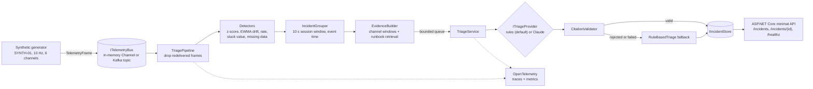

# telemetry-triage

[](https://github.com/KyleSau/telemetry-triage/actions/workflows/ci.yml)

AI-assisted anomaly triage for streaming vehicle / ground-station telemetry, in C# / .NET 9.

Deterministic detectors watch a telemetry stream, and correlated anomalies are grouped into incidents.
For each incident, a triage provider writes a structured report: likely cause, affected subsystems,
severity, recommended checks, and **citations to the evidence and runbook sections it used**. The provider is
an offline rule-based engine by default, or Claude via the official Anthropic C# SDK. A validator rejects any
report that cites evidence that does not exist or quotes numbers that are not in the evidence. Every stage
emits OpenTelemetry traces and metrics: latency, anomaly and incident counts, LLM tokens, and estimated cost.

> **Synthetic data only.** All telemetry is generated by a seeded simulator for a fictional vehicle called
> `SYNTH-01`. Channel names, limits, and runbooks are invented for this demo. This project is not affiliated
> with any company or real program, and it uses no real telemetry.

## The problem

An operator watching high-rate telemetry needs answers to four questions: *what is anomalous, which anomalies
are the same problem, how bad is it, and what should I check first?* Statistical detectors are fast, cheap and
explainable, but they produce a list of alerts with no story. An LLM can write the story, but it is slow, costs
money per call, and can invent facts. This project splits the job:

1. **Hot path, deterministic:** ingest, then detect, then group. This runs in microseconds per frame, has no
   network calls, and gives the same answer every time.
2. **Cold path, AI-assisted:** one triage call per *closed incident*. The call is constrained to an evidence
   pack and validated before anyone sees it. If validation fails, the rule-based report is used instead.

## Architecture



| Project | Responsibility |
|---|---|
| `src/TelemetryTriage.Core` | Domain logic: generator, detectors, grouping, evidence, triage contracts, rule-based provider, citation validator, evals. It has no Kafka, HTTP, or LLM dependencies. |
| `src/TelemetryTriage.Infrastructure` | Adapters: Kafka bus (Confluent.Kafka), Claude provider (Anthropic SDK), and the OpenTelemetry + DI composition shared by both hosts. |
| `src/TelemetryTriage.Api` | Minimal API, plus a `BackgroundService` that runs the pipeline in-process. |
| `src/TelemetryTriage.Cli` | `run`, `publish`, `evals`, and `scenarios` commands. |
| `tests/TelemetryTriage.Tests` | xUnit tests: detectors, grouping, validator, buses, pipeline idempotency, Claude provider (fake HTTP), API (WebApplicationFactory), Kafka (integration, opt-in), and evals. |
| `runbooks/*.md` | Fictional runbooks used for retrieval and citations. |
| `evals/golden-set.json` | Golden fault scenarios with expected properties. |
| `deploy/k8s/` | **Example** Kubernetes manifests (Deployment, Service, ConfigMap). They are not a production deployment. |

For a guided code tour, the reasons behind each design decision, and likely interview questions, see
[docs/WALKTHROUGH.md](docs/WALKTHROUGH.md).

## Quickstart

Prerequisites: .NET 9 SDK. Docker is optional and only needed for the Kafka path. Everything below works offline.

```bash
dotnet build
dotnet test                                    # Kafka integration tests are skipped without a broker

dotnet run --project src/TelemetryTriage.Cli -- scenarios
dotnet run --project src/TelemetryTriage.Cli -- run --scenario correlated-fault              # spans + metrics on the console
dotnet run --project src/TelemetryTriage.Cli -- run --scenario spike --otel none --json out.json
dotnet run --project src/TelemetryTriage.Cli -- evals                                        # exit code 1 on any failed check

dotnet run --project src/TelemetryTriage.Api   # replays correlated-fault on startup
curl http://localhost:5080/incidents
curl http://localhost:5080/incidents/INC-SYNTH-01-000300
curl http://localhost:5080/healthz
```

### Kafka (single-node KRaft broker in Docker)

```bash
docker compose up -d --wait kafka
dotnet run --project src/TelemetryTriage.Cli -- run --scenario correlated-fault --bus kafka
KAFKA_BOOTSTRAP_SERVERS=localhost:9092 dotnet test --filter "FullyQualifiedName~KafkaTests"

docker compose up -d --build api               # API container consuming telemetry.synth-01 continuously
dotnet run --project src/TelemetryTriage.Cli -- publish --scenario correlated-fault
curl http://localhost:8080/incidents
docker compose down
```

### Claude (optional)

```bash
export ANTHROPIC_API_KEY=...                   # never committed; read from the environment only
dotnet run --project src/TelemetryTriage.Cli -- run --scenario correlated-fault --triage claude
dotnet run --project src/TelemetryTriage.Cli -- evals --live
```

Configuration is standard .NET configuration (appsettings, environment variables such as `Bus__Kind=kafka`):
`Bus:Kind` (`inmemory`|`kafka`), `Triage:Provider` (`rules`|`claude`), `Claude:Model`, `Claude:Effort`,
`Pipeline:Scenario`, `Pipeline:IncidentGap`, `Pipeline:TriageConcurrency`, `Observability:Exporter`
(`console`|`otlp`|`none`).

## Scenarios

All scenarios are 600 frames (60 s at 10 Hz). Each fault starts at sample 300.

| Scenario | Injected fault | Expected outcome (golden set) |
|---|---|---|
| `nominal` | none | 0 incidents |
| `spike` | `attitude_rate` +1.2 deg/s for one sample | caught within 1 sample; Low |
| `sensor-dropout` | `battery_temp` absent from frames for 5 s | caught within 5 samples; Medium |
| `stuck-value` | `tank_pressure` frozen for 10 s | caught within 10 samples; Medium..High |
| `drift` | `avionics_temp` ramps +0.04 degC/s | caught within 60 samples; Medium..High |
| `correlated-fault` | bus voltage sags 3.2 V, then battery temperature climbs and link SNR drops 6 dB | all 3 channels in **one** incident; High..Critical |

## Sample output (real run, offline provider)

The following was produced on the build machine (Windows 11, .NET SDK 9.0.318) by
`dotnet run --project src/TelemetryTriage.Cli -c Release -- run --scenario correlated-fault`, using the default
**offline rule-based provider. No LLM was involved.** Log timestamps are local wall-clock time; the
OpenTelemetry span blocks are omitted here and shown in the next section.

```text
Scenario 'correlated-fault': Power bus sags 3.2 V; battery temperature then climbs and link SNR drops 6 dB (shared root cause). (synthetic data, stream SYNTH-01, bus inmemory)
13:55:36.863 info: TelemetryTriage.Core.Pipeline.TriagePipeline[0] Anomaly anom:bus_voltage:zscore:300: z = -19.0 (|z| > 5); rolling mean 28.003, std 0.050 over 100 samples
13:55:36.875 info: TelemetryTriage.Core.Pipeline.TriagePipeline[0] Anomaly anom:bus_voltage:rate:300: rate -9.31 V/s exceeds the 5 V/s plausibility limit
13:55:36.875 info: TelemetryTriage.Core.Pipeline.TriagePipeline[0] Anomaly anom:link_snr:zscore:305: z = -8.2 (|z| > 5); rolling mean 18.006, std 0.300 over 100 samples
13:55:36.875 info: TelemetryTriage.Core.Pipeline.TriagePipeline[0] Anomaly anom:bus_voltage:ewma-drift:305: EWMA 27.955 is -0.048 V from baseline 28.003 (limit 0.047)
13:55:36.875 info: TelemetryTriage.Core.Pipeline.TriagePipeline[0] Anomaly anom:link_snr:ewma-drift:309: EWMA 17.685 is -0.292 dB from baseline 17.977 (limit 0.285)
13:55:36.876 info: TelemetryTriage.Core.Pipeline.TriagePipeline[0] Anomaly anom:battery_temp:ewma-drift:311: EWMA 22.047 is 0.052 degC from baseline 21.996 (limit 0.047)
13:55:36.876 info: TelemetryTriage.Core.Pipeline.TriagePipeline[0] Anomaly anom:battery_temp:zscore:315: z = 5.2 (|z| > 5); rolling mean 22.017, std 0.087 over 100 samples
13:55:36.881 info: TelemetryTriage.Core.Pipeline.TriagePipeline[0] Incident INC-SYNTH-01-000300 closed: bus_voltage,link_snr,battery_temp (7 anomalies)
13:55:36.962 info: TelemetryTriage.Core.Pipeline.TriagePipeline[0] Triaged INC-SYNTH-01-000300: Critical via rules (Accepted) in 58.97 ms

Processed 600 frames, 7 anomalies, 1 incident(s), 0 duplicates dropped.

=== INC-SYNTH-01-000300  severity=Critical  provider=rules/rule-based-v1  status=Accepted  triage=58.97 ms
Channels:     bus_voltage, link_snr, battery_temp  (subsystems: EPS, Comms)
Summary:      Detectors flagged bus_voltage, link_snr, battery_temp (EPS, Comms) starting at sample 300; first signal: rate on bus_voltage.
Likely cause: Correlated excursion across EPS, Comms. bus_voltage moved first at sample 300 (27.055 V vs baseline 28.003), followed by link_snr, battery_temp. A shared upstream cause in EPS is more likely than independent faults.
Recommended checks:
  - Compare bus voltage with battery temperature and current: a hot battery plus low bus voltage suggests a high-current load fault.  [rb:eps-power#bus-undervoltage, anom:bus_voltage:rate:300]
  - Identify loads switched on in the 10 s before the voltage step (command history).  [rb:eps-power#bus-undervoltage, anom:bus_voltage:rate:300]
  - Check whether the SNR drop lines up with a bus voltage change in the same incident.  [rb:comms-link#link-snr-degradation, anom:bus_voltage:rate:300]
  - Check ground-station antenna pointing and weather before blaming the vehicle.  [rb:comms-link#link-snr-degradation, anom:bus_voltage:rate:300]
Citations:    anom:bus_voltage:rate:300, anom:bus_voltage:zscore:300, anom:bus_voltage:ewma-drift:305, anom:link_snr:zscore:305, anom:link_snr:ewma-drift:309, anom:battery_temp:ewma-drift:311, anom:battery_temp:zscore:315, win:bus_voltage, win:link_snr, win:battery_temp, rb:eps-power#bus-undervoltage, rb:comms-link#link-snr-degradation
```

The 58.97 ms triage time includes first-call warm-up (JIT and JSON serialization). In the eval run below, the
rule-based triages for all five fault scenarios took about 31 ms in total.

`GET /incidents/{id}` returns the incident, the full evidence pack (anomalies, channel windows with baseline
statistics, and retrieved runbook sections), and the triage outcome: report, provider, model, status,
validation issues, latency, tokens, and estimated cost.

## Observability

Core uses only the BCL `ActivitySource` and `Meter` (`System.Diagnostics`). The hosts subscribe to them with
the OpenTelemetry SDK and export to the console by default, or to OTLP with `Observability:Exporter=otlp` and
the standard `OTEL_EXPORTER_OTLP_*` variables.

| Signal | Name | Notes |
|---|---|---|
| span | `pipeline.run` | one per pipeline run; tags: frames, incidents |
| span | `triage.incident` | one per incident; tags: provider, status, `gen_ai.request.model`, `gen_ai.usage.*`, cost |
| histogram | `detection.duration` (ms) | all detectors on one frame; explicit sub-ms buckets |
| histogram | `telemetry.ingest.lag` (ms) | publish time to processing time |
| histogram | `triage.duration` (ms) | provider call + validation (+ fallback) |
| histogram | `triage.cost` (USD) | estimated from a configurable price table |
| histogram | `gen_ai.client.token.usage` | per call, tagged `gen_ai.token.type` = input/output (OTel GenAI conventions) |
| counter | `detection.anomalies` | by detector and channel |
| counter | `incidents.triaged` | by severity and triage status |
| counter | `triage.validation.failures` | reports rejected by the citation validator |
| counter | `telemetry.frames.ingested`, `telemetry.frames.duplicates` | throughput and redelivery |

Console excerpt from the same run as above (verbatim, with some blocks removed where marked):

```text
Activity.TraceId:            42dfd9b47d60937fddc42e04abc7b306
Activity.SpanId:             7660c7e3b5cb8802
Activity.TraceFlags:         Recorded
Activity.ParentSpanId:       d4ef8a6af1239d90
Activity.DisplayName:        triage.incident
Activity.Kind:               Internal
Activity.StartTime:          2026-10-13T20:55:36.8948194Z
Activity.Duration:           00:00:00.0607137
Activity.Tags:
    incident.id: INC-SYNTH-01-000300
    triage.provider: rules
    triage.status: Accepted
    gen_ai.request.model: rule-based-v1
    gen_ai.usage.input_tokens: 0
    gen_ai.usage.output_tokens: 0
    triage.cost_usd: 0
...
Metric Name: detection.duration, Description: Time to run all detectors on one frame, Unit: ms, Metric Type: Histogram
Instrumentation scope (Meter):
	Name: TelemetryTriage
(2026-10-13T20:55:36.8250832Z, 2026-10-13T20:55:37.0925960Z]
Value: Sum: 49.212900000000076 Count: 600 Min: 0.0036 Max: 20.3316
(-Infinity,0.01]:28
(0.01,0.025]:27
(0.025,0.05]:526
(0.05,0.1]:15
(0.1,0.25]:0
(0.25,0.5]:0
(0.5,1]:0
(1,5]:3
(5,25]:1
(25,+Infinity]:0
...
Metric Name: incidents.triaged, Description: Incidents triaged, by severity and status, Unit: {incident}, Metric Type: LongSum
Instrumentation scope (Meter):
	Name: TelemetryTriage
(2026-10-13T20:55:36.8251145Z, 2026-10-13T20:55:37.0925968Z] severity: Critical triage.status: Accepted
Value: 1
```

In this run, 526 of 600 frames ran all five detectors in 25-50 microseconds. The few slow frames are most likely JIT
warm-up. The ingest-lag histogram for this run (not shown) sits between 25 and 100 ms only because the replay
publishes all 600 frames at once. It measures queueing, not per-frame processing time.

## Evals

`evals/golden-set.json` lists the fault scenarios and the **properties** each must satisfy. The checks test
properties, not exact text, so they work for both the deterministic and the LLM provider:

- **Detection latency:** the expected detector catches the fault on the expected channel within N samples
  of the injected start.
- **Incident count and grouping:** for example, all three correlated-fault channels must land in one incident.
- **Citations:** the provider's own report was accepted, and re-validation finds only real evidence ids and
  grounded numbers.
- **Severity bounds and ordering:** for example, correlated-fault > stuck-value > spike.

Real output of `dotnet run --project src/TelemetryTriage.Cli -c Release -- evals` (offline, rule-based):

```text
PASS  nominal           incident-count                       expected 0, got 0
PASS  spike             detect:attitude_rate                 rate after 0 samples (budget 1)
PASS  sensor-dropout    detect:battery_temp                  missing after 4 samples (budget 5)
PASS  stuck-value       detect:tank_pressure                 stuck after 9 samples (budget 10)
PASS  drift             detect:avionics_temp                 ewma-drift after 26 samples (budget 60)
PASS  correlated-fault  detect:battery_temp                  ewma-drift after 9 samples (budget 30)
PASS  correlated-fault  grouping                             3 fault channels spread over 1 incident(s)
PASS  correlated-fault  citations:INC-SYNTH-01-000300        all citations and numbers grounded
PASS  correlated-fault  severity                             expected High..Critical, got Critical
PASS  ordering          correlated-fault>stuck-value         Critical vs Medium
... (22 more PASS lines)

32/32 checks passed (provider: rules). Triage latency total 30.8 ms, tokens in/out 0/0, estimated cost $0.0000.
```

The same checks also run as an xUnit test. A second test plugs in a deliberately hallucinating provider and
asserts that the evals **fail**, so the citation checks are known to catch bad output. The command exits with
code 1 when any check fails (verified with a deliberately wrong golden file).

**Measured false-alarm rate:** across 300 nominal runs (seeds 1-300, about 1.08 M channel-samples), the
detector suite raised 2 false-alarm episodes, both just over threshold. A test bounds this at 2 or fewer
per 100 runs. The thresholds trade sensitivity against this rate, and the number is measured rather than tuned
away.

## Claude integration

`ClaudeTriageProvider` uses the official `Anthropic` NuGet package (v12.55.0), on the beta Messages endpoint:

- **Model** `claude-opus-5-5` (configurable). **Adaptive thinking**, with **effort set explicitly**
  (`medium` by default, configurable). No `budget_tokens`, no forced `tool_choice`, no assistant prefill.
- **Structured outputs:** `output_config.format` with a JSON schema that mirrors `TriageReport`, with
  `additionalProperties: false` on every object.
- **`stop_reason` is checked before content is used:** `refusal` (with the `stop_details` category) and
  `max_tokens` become failed attempts, and the rule-based report is used instead.
- **Server-side refusal fallback:** `fallbacks: "default"` with the `server-side-fallback-2026-07-01` beta.
  The C# SDK expresses this directly (`BetaFallbacksParam` with its `Default` variant), so no workaround was
  needed. A test asserts both appear on the wire.
- **Typed SDK errors:** `AnthropicRateLimitException`, `Anthropic5xxException`, `AnthropicIOException`,
  `AnthropicBadRequestException`, and `AnthropicApiException` each map to a failed attempt with a clear reason.
  SDK retries are configurable.
- **Cost:** estimated from the served model's token usage and a configurable price table. The defaults are
  $4 / $20 per million input / output tokens for `claude-opus-5-5`, taken from Anthropic's documentation at the
  time of writing. Verify them against current pricing. With a server-side fallback, only the top-level usage of
  the serving attempt is counted, so the estimate can undercount when a fallback happened.

**Not verified live.** The build machine had no API key, so the provider was never called against the real
API. Its request and response handling is tested by running the real SDK against a fake `HttpMessageHandler`
with hand-written fixture responses (success, hallucinated citation, refusal, `max_tokens`, 429). **No Claude
output appears anywhere in this README.**

## Streaming semantics (Kafka)

- One topic per stream (`telemetry.<stream>`), messages keyed by stream id, one partition per topic so frames
  stay in order. Producer: `acks=all`, idempotence on, non-blocking `Produce` with delivery reports, and a
  flush on completion.
- **At-least-once:** `enable.auto.offset.store=false` plus auto-commit. The pipeline stores a frame's offset
  only after it has processed (acked) that frame, so a crash re-delivers anything unacked.
- **Idempotent processing:** frames at or below the last processed sequence number are dropped, and incident
  ids are deterministic (`INC-{stream}-{first sample}`), so reprocessing produces upserts, not duplicates.
  Two integration tests cover this against a real broker: an end-to-end scenario, and redelivery of unacked
  frames to the same consumer group.

## What was verified, and what was not

| Item | Status on the build machine (Windows 11, .NET SDK 9.0.318) |
|---|---|
| `dotnet build -warnaserror`, `dotnet format --verify-no-changes` | run, clean |
| `dotnet test` | run: 40 passed, 2 skipped (Kafka integration tests skip without a broker) |
| Offline evals | run: 32/32 |
| Kafka path | run locally on Docker Desktop with the compose broker (`apache/kafka:3.9.1`): CLI `--bus kafka`, the 4 Kafka tests including both integration tests, and the API container consuming the topic |
| API Docker image | built and run, including as non-root with a read-only root filesystem and all capabilities dropped |
| Kubernetes manifests | YAML parsed and cross-checked by script; **not applied to a cluster** |
| Live Claude calls, `evals --live` | **not run** (no API key); SDK path covered by fake-HTTP tests |
| GitHub Actions workflow | written, **not yet run** (the repository has not been pushed) |
| OTLP exporter | configured; **not run** against a collector |

## Limitations

- The data is synthetic white noise around fixed nominal values. Real telemetry has operating modes (for
  example, eclipse), multi-rate channels, quantization, and seasonality, so detectors would need mode-aware
  baselines.
- Detector thresholds are hand-set. The false-alarm rate is measured on synthetic data only.
- Each pipeline handles one stream, and detector state lives in memory. After a restart, detectors re-warm for
  about 10 s.
- The incident store is in-memory, so the K8s example runs one replica.
- Number grounding checks that a number *appears* in the evidence, not that it is attributed to the right
  channel. Integers up to 10 are exempt (counts and ordinals). Derived numbers such as differences are
  rejected on purpose, which can reject a correct but paraphrased LLM report.
- Runbook retrieval is keyword overlap, which works for 6 runbooks and would not scale.
- An incident closes 10 s after the last *new* anomaly episode. A fault that persists does not re-alert.
- Re-publishing a stream with the same sequence numbers is dropped as duplicates (by design). Use a new stream
  id.
- Kafka: undecodable messages are logged and skipped (no dead-letter topic), and frames are JSON with no
  schema registry.

## Roadmap

- Run `evals --live` and compare Claude against the rule-based baseline on quality, latency, and cost per
  incident; add a single repair attempt that feeds validator errors back before falling back.
- Constrain citations at decode time with a per-request JSON-schema `enum` of evidence ids. The trade-off is
  per-schema compilation latency, versus a cached static schema.
- Persist incidents (SQL Server) with an outbox written before offsets are committed; snapshot detector state.
- Dead-letter topic; Avro or Protobuf with a schema registry.
- ASP.NET Core and HttpClient OpenTelemetry instrumentation; a Grafana dashboard.
- Helm or kustomize; autoscaling on consumer lag.
- BM25 or embedding retrieval once there are more runbooks.

## How this was built

Built with AI-assisted development, using Claude Code as a pair programmer. Every output shown in this README
(logs, triage, metrics, eval results) was copied from an actual local run with the offline provider.

## License

[MIT](LICENSE)
